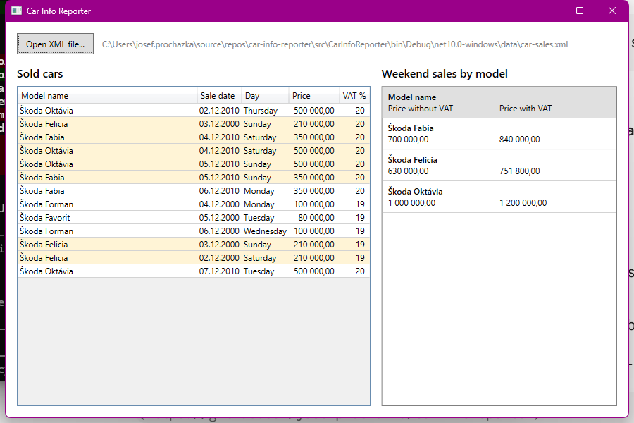

# Car Info Reporter

A small WPF application that loads sold cars from an XML file and shows, for each car model,
the total price of the cars sold on a weekend, without and with VAT.

It is a solution of a practical interview assignment, see [docs/assignment](docs/assignment).



## How to run

Requirements: Windows and the [.NET 10 SDK](https://dotnet.microsoft.com/download) (or Visual Studio 2026 with the ".NET desktop development" workload).

- **Visual Studio:** open `CarInfoReporter.sln` and press <kbd>F5</kbd>.
- **Command line:**

  ```
  dotnet run --project src/CarInfoReporter
  ```

Then:

1. Click **Open XML file...**
2. Select `car-sales.xml`. The dialog opens directly in the folder with the sample file
   (the original is in [data/car-sales.xml](data/car-sales.xml)).
3. The left table shows all cars from the file, weekend sales are highlighted.
   The right table shows the weekend totals for each model.

Run the tests with `dotnet test`.

## XML format

```xml
<CarSales>
  <CarSale>
    <ModelName>Škoda Oktávia</ModelName>
    <SaleDate>2010-12-02</SaleDate>   <!-- ISO 8601 date -->
    <Price>500000</Price>             <!-- price without VAT -->
    <VatRate>20</VatRate>             <!-- VAT rate in percent -->
  </CarSale>
  ...
</CarSales>
```

The values are stored in the standard XML formats, so the file does not depend on the language of the computer.

## Project structure

```
data/car-sales.xml              sample data from the assignment
docs/assignment/                the original assignment (PDF) and its English translation
src/CarInfoReporter/
  Models/CarSale.cs             one sold car (one row of the XML file)
  Models/ModelSummary.cs        weekend totals of one model
  Services/CarSalesXmlReader.cs         XML file -> list of CarSale
  Services/WeekendSalesCalculator.cs    list of CarSale -> list of ModelSummary
  Services/IDialogService.cs            the dialogs the view model needs (select a file, show an error)
  Services/DialogService.cs             their implementation with the standard Windows dialogs
  ViewModels/MainViewModel.cs   the "Open XML file" command and the data shown in the window
  MainWindow.xaml               the window
tests/CarInfoReporter.Tests/    unit tests of the reader, the calculator and the view model
```

## Notes

- **Stack:** C#, .NET 10, WPF, MVVM with [CommunityToolkit.Mvvm](https://learn.microsoft.com/dotnet/communitytoolkit/mvvm/), xUnit.
- **MVVM:** the window (`MainWindow.xaml`) contains only the layout and bindings. The view model does not touch the UI,
  it opens dialogs through `IDialogService`, so it is tested with a fake one and no window is needed.
- **Money is `decimal`, not `double`.** The assignment lists the price and VAT as `double`, but `decimal` is the right type
  for money, because it does not have the rounding errors of binary floating point numbers.
- **VAT is calculated for each sale.** The same model is sold with different VAT rates in the sample data
  (Škoda Felicia with 19 % and 20 %), so the price with VAT cannot be calculated from the summed price.
- **Number and date format is Czech** (`1 000 000,00`, `04.12.2010`), as in the assignment. The prices are in CZK.
- **Invalid files** (not XML, wrong root element, missing element, invalid value) are reported with a message
  that says what is wrong and on which line.

### Expected result for the sample data

| Model name    | Price without VAT | Price with VAT |
|---------------|------------------:|---------------:|
| Škoda Fabia   |        700 000,00 |     840 000,00 |
| Škoda Felicia |        630 000,00 |     751 800,00 |
| Škoda Oktávia |      1 000 000,00 |   1 200 000,00 |
